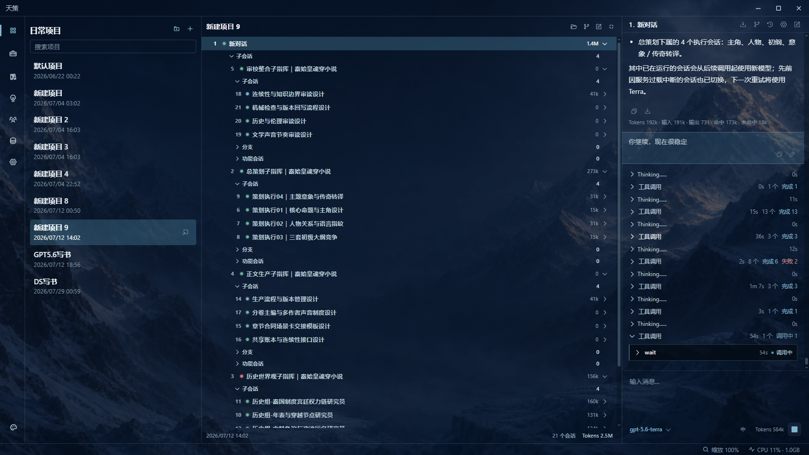
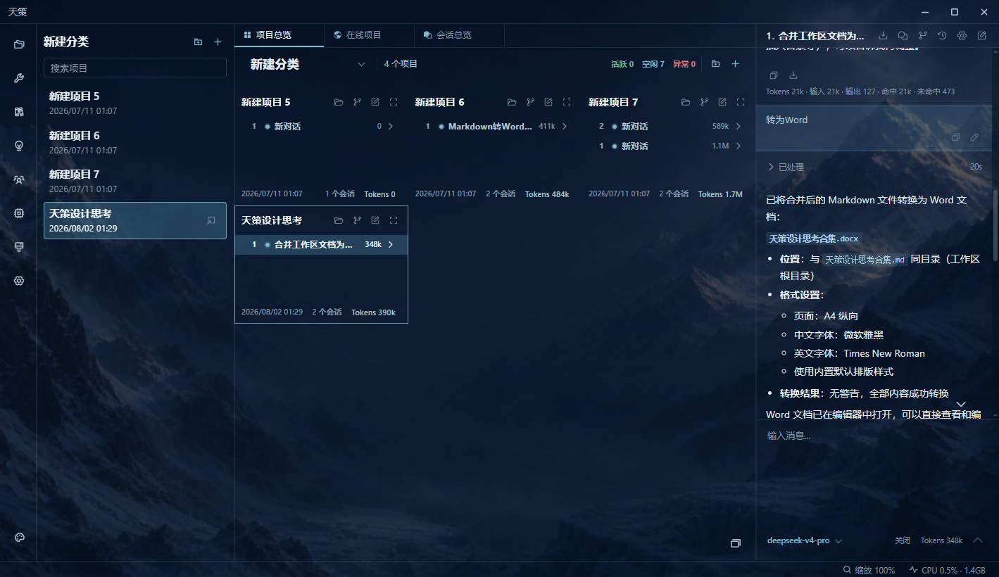

# 天策 Tiance

**AI 做事靠工具，项目就是文件夹。**

一个让你看得懂 AI 怎样干活的 Windows 桌面软件。管理项目和文件，让一个或多个 AI 工作，随时打开它们的会话，查看过程、补充要求或停止任务。

[](https://github.com/LikeMirage/Tiance/releases/latest)
[](LICENSE)

**[下载 Windows 版](https://github.com/LikeMirage/Tiance/releases/latest/download/Tiance.zip)** · [开始使用](#开始使用) · [开发与设计文档](#开发与设计文档)

## 为什么做天策

我给客户讲 AI 时，经常发现一件事：名词讲了一堆，对方还是不知道，发出一句话以后，程序究竟做了什么。

Agent、Workflow、Skill、各种“智能体编排”……一个产品可以介绍得很厉害，真正用起来，却只剩一个输入框和“正在思考”。它读了什么文件？为什么叫来另一个 AI？任务卡在哪里？花了这么多 Token，到底是哪一步花的？用户只能猜。

我做天策，就是不想继续接受这种黑盒。

术语有用的时候可以用，但别拿一堆新名字，把原本能讲清楚的事说玄乎。先告诉我材料在哪里、模型收到了什么、工具执行了什么、结果怎么来的。把这些讲清楚以后，再讨论该叫它什么。

天策按三个朴素的想法来做：

- **AI 的行动，通过标准工具调用。** 读文件、搜索、运行程序、修改文档，甚至创建另一个 AI 会话，都有具体的工具和调用记录。
- **各类内容，按真实文件夹组织。** 普通项目、工具、角色、主题、供应商都有自己的目录，里面的文件决定它的用途。
- **AI 的工作，留下能打开的会话。** 主任务、子任务、记忆压缩和记忆管理，都有过程可查。

第一次接触 AI 的人，也应该有机会把这些看明白。

## 所谓 Agent，先看它怎么干活

假设你交给 AI 一件事：“分析这个销售表，画几张图，再写一份 Word 报告。”

一次可能的过程是：

1. 模型提出工具调用，读取你指定的表格。
2. 程序执行工具，把读取结果交回模型。
3. 模型根据结果继续调用工具，运行分析、保存图表、写报告。
4. 调用文档转换工具生成 Word，最后告诉你结果放在哪里。

**模型提出调用，程序执行，结果交回模型，再决定下一步。** 常见 Agent 应用的工作过程，可以从这个循环看起。具体任务需要哪些步骤、能否做好，还取决于模型、给它的材料、可用工具和程序的执行规则。

在天策里，你可以展开工具调用，看到参数、结果和错误，也可以查看请求记录，核对实际发给模型的内容。需要权限确认的操作，由程序检查并询问。

你可以只看最后的结果；想弄清楚时，也能继续往里看。不需要一开始就读代码或学一套术语。

## 多个 AI 协作，也有具体过程

AI 想找另一个 AI 帮忙，就通过工具创建会话、选择模型和工具、发送任务，再等待或读取回复。新会话出现在会话树里，你可以点进去看它做了什么。

不同会话可以使用不同供应商和模型。一个负责分析，一个检查数据，一个写报告，它们之间的任务和回复都有记录。需要调整时，你可以进入相应会话补充要求，或停止正在执行的任务。



图中左侧是项目，中间展开的是会话与子会话，右侧是当前会话的回复和工具调用。子会话还可以继续创建自己的子会话。

自动命名、记忆压缩、项目记忆管理等后台 AI 工作，也使用可查看的会话。比如历史太长需要压缩，你能找到负责压缩的会话，查看它拿到了什么、生成了什么摘要、是否成功提交。压缩改变后续发给模型的上下文，原始聊天记录仍保留。

## 工具、角色、主题，都能找到它的文件夹

普通项目可以使用天策创建的目录，也可以使用你已有的工作文件夹。资料、源码和生成的文件就放在里面，能用资源管理器或其他软件打开。

工具、角色、主题和供应商也沿用项目的组织方式：

| 你在界面里看到的 | 文件夹里实际放着的 |
| --- | --- |
| 工具 | 用途和参数说明、程序、资源、依赖等文件 |
| 角色 | 角色提示词与相关配置 |
| 主题 | 主题配置、图片等资源 |
| 供应商 | 协议、模型与适配配置 |
| 普通项目、知识和经验项目 | 你的资料、工作文件和项目内的会话数据 |

这些项目共用文件浏览、会话、分类等能力。工具集把工具配置放在前面，模型集把供应商和模型配置放在前面；内容仍能在对应目录中找到。

这里的“文件夹”说的是项目怎样组织。会话和消息保存在项目内的 `.Tiance/tiance.db` 中；一条消息不会再造一个文件夹。分类索引和全局设置也有各自的保存位置。

天策把项目和会话数据保存在本地。使用在线模型、网络搜索等服务时，相应内容仍会发送给你选择的服务，**本地保存不等于离线运行**。

## 连制作工具，也可以交给工具

天策提供“新建空白工具”。AI 调用它，就能在指定分类下创建一个工具项目，配齐配置、程序入口、测试示例和制作资料。一个 Python 工具的目录大致如下：

```text
工具项目/
  .tool/                  名称、参数、返回格式和权限等配置
  program/
    main.py               执行程序
    requirements.txt      Python 依赖声明
  assets/                 按需放置资料与资源
  tests/                  测试示例
  docs/tool-development/  创建时附带的制作说明
```

新工具默认关闭。你可以让 AI 先读随附文档，再按要求编写和验证，完成后决定是否启用。现有工具的文件和代码也可以查看，看看它究竟如何工作。

工具可以处理文件，也可以通过已有接口操作天策的会话和界面、使用供应商能力。扩展超出现有接口的能力时，仍需要修改相应程序；具体接入方式留在[工具制作文档](docs/29_工具制作与空白模板.md)里。

## 现在可以拿它做什么

- **围绕实际资料工作。** 打开项目，引用文件、文件夹或其他项目，让 AI 读取材料、分析和生成文件。
- **制作和修改文档。** 使用 Markdown、Word、Excel、PPT 等工具；Markdown 可转换为可编辑 Word，支持模板、图片、表格和数学公式。Word 预览中的选区可以引用到对话，供工具定位修改。
- **搜索、运行程序、处理代码。** 使用网络搜索、文件检索、Python、Git、GitHub 等工具，并查看执行结果。
- **同时推进多件事。** 在项目与会话间切换，安排多个 AI 工作；从历史消息创建分支，保留不同尝试。
- **检查工作和花费。** 查看模型请求、工具调用、失败记录、Token 用量和任务耗时，定位哪一步出了问题。
- **安装和修改现成内容。** 从在线市场获取工具、角色、主题、供应商等项目，安装后仍能查看本地内容。



项目总览把各项目的会话和状态放在一起；进入项目后，中间区域也可以用来浏览文件、编辑和预览文档。

## 开始使用

目前提供 Windows 发布包，已经包含 Python、后端依赖和构建好的前端，无需另外安装 Python 或 Node.js。

1. [下载最新 Windows 版](https://github.com/LikeMirage/Tiance/releases/latest/download/Tiance.zip)，解压并保留完整目录结构。
2. 双击根目录的 `Tiance.exe`，确认 Windows 管理员授权后启动。
3. 在模型集中配置自己的供应商与 API Key。
4. 创建项目或打开已有工作文件夹，新建会话，选择模型和需要的工具，开始工作。

当前 Windows 启动器要求管理员权限，工具进程也会沿启动链继承权限。天策内部另有工具权限控制，使用前请了解[当前限制与运行要求](docs/11_当前限制与风险边界.md)。

软件支持通过 GitHub Releases 更新，更新包保留用户项目和配置。使用 Git 克隆源码的目录应继续通过 Git 更新。

## 这个项目还在开发

天策从 2026 年 4 月底开始迭代，2026 年 8 月 2 日首次系统整理并开放源码。由业余产品经理主导，主要借助 AI 编程完成。

我希望把 AI 应用做得容易理解，但这不代表程序已经没有问题。持续使用中暴露的隐蔽错误，会记录原因和修复要求；[这份问题记录](docs/22_隐式截断与隐藏默认值专项问题分析.md)也公开在仓库里。自动化测试和 AI 审查不能替代专业人工安全审计。

目前没有可直接运行的 macOS 或 Linux 发布包。知识集和经验集已有项目入口，专用功能尚未开始；接口和数据格式仍可能随开发调整。

反馈问题时，欢迎说明你当时想做什么、实际发生了什么，以及能否重复出现。产品里的过程看不懂，也值得反馈。

## 开发与设计文档

想直接看源码，可以克隆后运行仓库中的 `Tiance.exe`：

```powershell
git clone https://github.com/LikeMirage/Tiance.git
cd Tiance
```

后端在 `1_PythonServer/`，React 前端在 `2_ReactWeb/`，桌面壳在 `3_PyWebView/`。内置内容在 `Data/`，随包运行环境在 `runtime/`。

<details>
<summary>前端开发与基础验证</summary>

需要 Node.js `>= 22.12.0` 和 pnpm：

```powershell
cd 2_ReactWeb
pnpm install
pnpm dev
```

桌面壳优先连接本机前端开发服务；没有开发服务时，加载 `2_ReactWeb/dist`。后端和桌面壳继续使用仓库内置环境。

```powershell
pnpm check
pnpm test:conversation-state
pnpm build
```

后端和桌面壳要求 Python `>= 3.11`。可配置环境变量分别见 `1_PythonServer/.env.example`、`2_ReactWeb/.env.example`、`3_PyWebView/.env.example`。完整流程见[开发、验证与发布](docs/09_开发验证与发布.md)。

</details>

| 想了解什么 | 从这里看 |
| --- | --- |
| 为什么这样设计，以及走过哪些弯路 | [天策设计思考](docs/00_天策设计思考合集.md) |
| 项目、会话和数据存在哪里 | [项目、会话与存储](docs/02_项目会话与存储.md) |
| 怎样制作、接入和控制工具 | [工具系统与权限](docs/05_工具系统与权限.md) · [工具制作与空白模板](docs/29_工具制作与空白模板.md) |
| 怎样调用不同模型、操作界面 | [LLM 协议与供应商](docs/04_LLM协议与供应商.md) · [前端能力桥与桌面壳](docs/06_前端能力桥与桌面壳.md) |
| 长会话、摘要和记忆怎样处理 | [模型上下文与记忆](docs/03_模型上下文与记忆.md) |
| Word 转换、预览和编辑细节 | [文档转换与文件监听](docs/08_文档转换与文件监听.md) |
| 其他设计与维护资料 | [文档索引](docs/00_文档索引.md) |

## 许可

本项目使用 [Apache License 2.0](LICENSE)。
