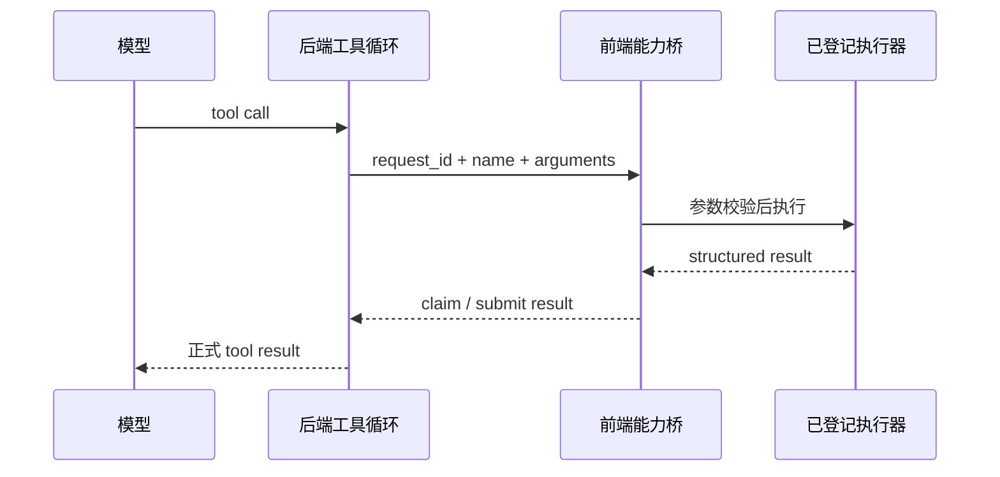

# 前端能力桥与桌面壳

## client tool 链路

有些能力依赖实时界面状态，例如打开标签、显示会话或读取当前编辑器选择。模型仍发起标准工具调用，后端创建 `client_tool_request`，前端按预先登记的能力名执行并提交结果。

能力名不是任意 JavaScript 函数名。前端注册表拒绝重复能力，未登记能力失败。项目归属必须来自工具调用上下文；当前可见项目只能影响纯 UI 展示，不能作为业务写入的兜底身份。

## 生命周期

后端维护等待请求、领取和结果提交。前端用单飞表避免同一进程内重放造成重复执行。取消等待不等于回滚已经完成的文件、会话或界面动作。

当前实现仍需要加强多执行器身份、请求租约和断线收敛。任何网页或窗口都不能仅凭自报 `executor_id` 获得高权限结果提交能力。

## 桌面 Shell API

pywebview 向前端暴露有限本机接口，包括窗口控制、原生文件/目录选择、路径显示或打开、托盘和更新相关动作。前端业务不应在各 feature 中直接读取 `window.pywebview`；应通过共享 desktop bridge 统一检测能力、处理失败和约束参数。

## 桌面启动和关闭

- 桌面壳选择后端端口并管理后端子进程。
- 前端开发服务可用时优先加载，否则使用 `dist`。
- 正常退出先经过未保存文档确认，再保存窗口尺寸、准备后台任务退出，最后销毁窗口；窗口销毁后的桌面收尾负责停止网关、后端和释放安装锁。收起到托盘不停止下载。
- 窗口尺寸属于尽力保存的偏好：原生尺寸查询与 HTTP 保存合计最多等待 2500 毫秒，超时中止请求并继续关闭/收起；迟到的尺寸查询不再触发保存。这一时限不作用于文档和会话。
- 桌面壳使用本次启动的后端实例 ID 和租约 Token，直接向后端 `POST /api/desktop/exit-preparation`。接口停止接受新的市场操作，取消未进入提交阶段的任务，返回真实剩余任务数。壳每 100 毫秒查询，单次本地请求最多等待 8 秒；文件提交没有强杀期限，窗口保留并显示正在退出，直到提交完成或回滚。
- 准备退出或销毁窗口失败时保留窗口，尝试通过 `DELETE /api/desktop/exit-preparation` 恢复接收新任务；已经取消的下载不会自动重试。后端不可达时明确显示退出失败，可重试退出。启动租约凭据不进入前端。
- 后端通用退出任务表只维护可取消/提交中的生命周期，业务结果仍由各市场拥有。线程任务必须结束后才能清理临时目录，避免取消协程却留下线程继续写入。该约定适用于正常退出，不能保证强制结束进程或断电时的文件完整性。
- 每个清理动作都应独立保护，前一项失败不能跳过后续资源释放。

## 性能面板与采样

状态栏显示天策进程树的 CPU 和内存汇总，性能页显示当前软件与本机整体占用，不保存或绘制历史曲线。页面沿用四个统计页的统一紧凑尺寸。

前端仅在性能页展开时每 5 秒请求一次，其余可见状态每 15 秒更新状态栏，窗口页面隐藏时停止定时请求，恢复可见后按采样间隔恢复；请求串行，没有逐帧动画或额外图表库。桌面壳用锁与 5 秒快照缓存合并重复请求，仅追踪自身及子进程，读取 CPU、RSS 和全机汇总内存，不扫描全机进程的路径、命令行或环境，不查询进程名称，不增加硬件传感器或 GPU 轮询。

`psutil.cpu_percent(interval=None)` 的系统基线按调用线程保存，不适合 pywebview 不同桥接线程间直接复用。采样器改为保存 CPU 原始时间差分基线；初次无基线时 CPU 返回空值，界面显示待取数符号。Windows 的 interrupt/dpc 和 Linux 的 guest 字段不重复计入总时间。

会话存储通过后端 `GET /api/workspace/storage` 单独按需统计，不能接入桌面壳的 CPU 采样器。服务从统一项目目录取得所有项目集已登记的根路径，去重后只枚举其 `.Tiance`；累计文件逻辑大小，不读取正文或打开会话数据库，不创建/升级数据库，不计安装程序与工作区文档。数据库分项包括 `tiance.db` 及 WAL/SHM/journal，其他文件单独汇总。

存储统计只在性能页可见时请求，前后端均保留五分钟缓存；收起和隐藏停止前端定时请求，没有后台持续扫描。后端互斥合并并发请求，枚举最多 50,000 项、每步检查两秒时间预算；不跟随符号链接和 Windows 重解析点。达到预算或存在无法读取/跳过的项目时返回 `complete=false`，界面用 ≥ 和简短提示显示已统计的下限，不把部分结果冒充总量。时间预算在文件系统调用之间检查，不是操作系统 I/O 的强制超时。CPU、内存和存储统计都不写用量账本或会话库。

## 信任边界

回环地址不是身份认证。正式运行必须把前端页面、当前后端实例和 Shell API 绑定到同一次启动，不能只信任 `localhost`、`file://` 或某个固定开发端口。

HTTP CORS 不保护 WebSocket。WebSocket、client tool claim/result、供应商配置和本机文件接口需要自己的会话身份与来源校验。

## 访问身份与登录生命周期

访问密码仍是单密码控制，不引入账户、角色或 JWT。网关是浏览器登录状态的唯一来源，登录记录只保存在当前网关进程内，重启失效，不写会话数据库。

- “桌面客户端免输密码”只认可当前桌面实例的随机凭证，不再依据回环 IP 放行。壳每次启动生成不同的桌面与内部后端凭证，通过匿名 stdin 管道把二者登记给网关；原生 WebView2 CookieManager 写入桌面专用 HttpOnly Cookie，JavaScript 桥只返回是否完成。授予身份的桥接方法校验当前文档的确切应用地址，不能因 `allow_remote_shell_api` 开启而向外部页面授予身份。
- 桌面身份绑定启动实例；开启桌面免密时不使用浏览器空闲计时。关闭免密、修改密码或撤销登录都会切断旧连接，仍被信任的桌面实例可重新连接。免密不适用于同一电脑的普通浏览器或本机反向代理。
- 浏览器随机令牌只存 HttpOnly、SameSite=Strict Cookie，HTTPS 时附加 Secure；服务端只保存令牌摘要。一小时无用户活动失效，最长登录有效期为 24 小时。输入、点击、触摸、滚轮经节流上报活动；不监听程序自动滚动也能触发的 scroll 事件。AI 输出、工具执行、API 轮询与心跳不刷新活动时间。
- 每个页面每 30 秒续约一次存活状态，页面租约为 90 秒。页面关闭发送 `session/leave`；最后一个页面离开后保留 15 秒刷新重连宽限。各标签页使用独立页面 ID，关闭一个不影响另一个；迟到心跳不能复活已关闭页面。浏览器崩溃、断网或后台冻结时由租约到期收回，不依赖关闭事件一定送达。网关每 15 秒清理过期记录，每次请求也检查到期，因此连接清理最多再延迟一个清理周期。
- 登出、空闲/绝对期限到期、修改密码和撤销登录均通过同一会话撤销信号终止其代理请求、WebSocket 与事件流。前端收到未登录响应后回到密码页。登录失效不是 AI 暂停指令：已提交给 conversation run manager 的任务继续执行，重新登录可恢复订阅。
- 网关仅接受 IP/localhost Host；自定义反向代理域名由 `TIANCE_GATEWAY_ALLOWED_HOSTS` 逗号列表显式声明。TLS 在代理终止时，另用 `TIANCE_GATEWAY_ALLOWED_ORIGINS` 声明准确的 HTTPS Origin。普通请求头、User-Agent 和转发头均不能授予桌面身份。HTTPS 仍需在外部访问设置或可信代理上配置。
- Python 后端继续仅监听回环，同时验证独立的 `X-Tiance-Gateway-Token`。网关覆盖外部同名头并移除浏览器 Cookie；后端在进入业务路由前移除内部凭证。健康检查和静态前端公开，六个专用工具能力入口保留原有短期、按能力授权，不能豁免整个路由前缀。关闭准备请求由壳携带内部凭证和原有实例租约双重校验。
- 网关健康接口声明 `security_protocol=2`，桌面壳拒绝启动旧网关，防止仅更新源码而实际程序仍使用旧鉴权方式。修改网关源码后必须重建并验证 `runtime/gateway/TianceRemoteGateway.exe`。

开发时若设置 `TIANCE_SHELL_MANAGE_BACKEND=false`，独立后端和壳必须显式配置相同的 `TIANCE_GATEWAY_INTERNAL_TOKEN`（64 位随机十六进制）；缺失时拒绝启动，不能降级为无鉴权后端。正常桌面启动自动生成并传递，不需要用户配置。

## 实现索引

- 后端 client bridge：`1_PythonServer/app/services/tools/client_tool_bridge.py`
- client 路由：`1_PythonServer/app/api/routes/llm/client_tools.py`
- 前端注册表：`2_ReactWeb/src/features/client-tools/model/clientToolBridge.ts`
- 前端桌面能力组合：`2_ReactWeb/src/features/desktop-shell/`
- 桌面 HTTP 服务：`2_ReactWeb/src/services/desktop/`
- 桌面 API：`3_PyWebView/app/api.py`
- 桌面运行时：`3_PyWebView/app/runtime.py`
- 桌面启动：`3_PyWebView/app/main.py`
