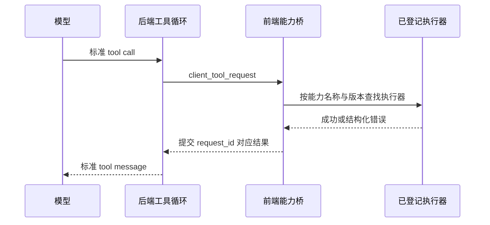

# 前端能力桥与会话管理工具

> 初始实现基线：2026-08-02；能力匹配及工具项目上下文于 2026-10-27 核对更新；2026-11-05 增加 editor.tabs v3 内容定位。

有些能力只能在浏览器界面里完成：切换编辑器标签、打开某个会话、读取当前工作区选择、让另一个可见会话开始运行。把这些动作搬进后端会失去真实前端状态；让模型直接执行任意 JavaScript 又会失去安全边界。

天策使用“前端能力桥”：模型仍然发起标准工具调用，后端只把经过登记的 client 工具请求送到前端，前端执行后再提交标准结果，工具循环随后继续。

## 一次 client 工具调用

后端为每次请求生成唯一 `request_id`，保存调用 ID、工具名、参数以及项目、会话和模型上下文，并等待结果。提交只能成功一次；未知、超时、已经提交或已经结束的请求会被拒绝。连接恢复时，只有仍在等待且未提交的请求才允许重放。

client 工具在进入前端能力桥之前先经过与 Python 工具相同的参数权限检查。策略为禁止时不会创建前端请求；策略为询问时，用户允许后才向前端发送请求，拒绝则直接形成标准工具失败结果。权限判断因此位于通用执行边界，不依赖某个前端执行器自己记得弹窗。

前端在启动时建立显式能力注册表。能力名称重复会立即失败，未登记或版本不满足的能力返回明确错误，不会被当作任意函数名执行。工具清单通过 runtime.client_capability 引用能力，调用名变更不要求按新名称添加分发分支。

请求中的 project_id/session_id 指调用方；tool_project_id 由后端从实际执行目标的注册信息取得，指向被调用工具自己的项目。前端若要读取该工具包的模板与资料，必须使用后者，不能回退为当前界面项目。动态包装器执行时携带实际目标工具的项目身份。

`tool.projects v1` 提供工具分类查询、分类创建和标准模板创建；复用已有分类、项目、文件接口，模板与资料放在调用工具自己的 assets 内。详细合同和扩展步骤见[工具制作与空白模板](29_工具制作与空白模板.md)。

## 编辑器标签与文件内容定位

`editor_tabs_manager` 使用 `editor.tabs v3`。原有列出、打开、聚焦和关闭已保存标签动作保留，新增 `reveal_file`，输入为 `action`、项目相对路径 `path` 和 `target`：

| target | 显示行为 |
| --- | --- |
| `{"type":"pdf_page","page":8}` | 加载 PDF 并显示第 8 页 |
| `{"type":"line_range","start_line":20,"end_line":35}` | 选中第 20 至 35 行文字并居中，首尾行均包含 |
| `{"type":"text","text":"待选中的原文","occurrence":2}` | 精确匹配并选中第 2 处；只有一处时可省略 occurrence |
| `{"type":"text_ranges","ranges":[{"type":"text","text":"关键词"},{"type":"line_range","start_line":20,"end_line":35}]}` | 一次选中多个范围，允许混合原文和行号，不设数量上限；从输入第一项居中展示 |

页码、行号和 occurrence 从 1 开始。未打开的文件自动打开，已有标签直接切换，当前标签也能重复定位。文本匹配使用 CodeMirror 实时缓冲区，保留未保存内容和输入防抖期间的新文字；大小写、空白必须一致，换行统一为 LF。使用真实编辑器选区，不写入高亮标记。Markdown/HTML 切换到源码，文本行号对应源码。

v3 的 text_ranges 要求非空数组，只接受 text/line_range 元素，不接受 PDF 或嵌套数组。全部范围先验证再一次性应用，任一项失败则整批报错并给出 range_index（从 1 开始），不部分选中。重叠/重复范围沿 CodeMirror 原生行为合并；主选区包含输入第一项，滚动仍定位第一项，不受文档位置排序影响。多范围 location 返回 text_selections 和按输入顺序的 ranges，原有 v2 单范围输入输出继续支持。

请求经 `useDocumentReveal` 附着到目标标签，再由文本编辑器或 PDF 渲染器回报。仅状态里出现标签不代表定位成功：文本需已应用选区且没有中途改变，PDF 需完成目标页渲染。阅读位置恢复会停止；成功返回 `displayed:true`、`location` 和 `revealed_tab`。请求不写进工作区持久化数据。取消、标签切换/关闭、后续定位替代和等待超时均有失败结果，迟到回报不能把失败改成成功；已经打开的标签不做回滚。

此动作只在调用方项目已处于编辑器前台时执行，其他项目返回 `PROJECT_NOT_ACTIVE`。旧动作对后台项目的标签元数据操作保持原样，不能据此宣称后台文件已展示。当前文本定位只支持文本编辑器文件；CSV/TSV 仍走表格预览，Office、图片等未开放文本选区接口。

“能打开”与“能定位”的范围需要在模型收到的工具说明里区分。标准工具 1.2.1 已明确写入摘要及 action/path/target，并注入“先区分打开文件与定位内容”短说明；开发文档不会代替工具参数进入模型上下文。对 DOCX 等返回 UNSUPPORTED_TARGET 时，附带预览类型、支持的定位类型（Office 为空）和 open_file 建议；这只能打开完整文件，不能声称已选中指定文字。

完整输入输出、错误码、并发与取消约定统一维护在[工具制作资料：editor.tabs v3](../Data/tools/34b16133-f310-4064-b71f-f0411d13ab1d/assets/documentation/04-capability-bridges.md#editortabs-v3标签与内容定位)，标准工具 Schema 和示例位于 `Data/tools/8e37be06-85d4-59ae-8791-71f7b4604ff9/.tool/`。使用新动作的工具须声明 `runtime.client_capability={"name":"editor.tabs","min_version":3}`。该升级复用现有 client 请求、取消和结果接口，不增加后端定位路由。

## 会话管理为什么属于前端工具

会话的持久化接口在后端，但“当前用户正在看哪个项目、应该把哪个会话展开、切换后如何刷新界面”属于前端状态。`manage_ai_conversations` 把稳定后端操作与真实界面反馈编排在一起。

当前支持的主要动作包括：

- 查询可用模型；
- 列出相关会话或整个项目会话；
- 读取会话摘要、完整消息和用量；
- 以当前会话为父节点创建 AI 子会话；
- 配置目标会话的模型、角色和工具；
- 停止、删除或显示目标会话。

删除必须显式确认；工具调用尚未返回时不能停止或删除自己。创建的会话会标记为 AI 创建并进入真实分支图，不是隐藏任务 ID。

`interact_ai_conversation` 负责向目标会话发送消息。它可以只发出任务立即返回，也可以等待目标会话完成本轮回复。来源会话会被记录，目标会话按普通后台运行机制启动或恢复，运行状态和用量仍然进入统一会话体系。

## 多 AI 协作因此保持可见

主会话可以：

1. 创建多个子会话；
2. 为它们选择不同模型、角色或工具；
3. 分别发送任务；
4. 等待其中部分结果；
5. 读取其它会话完整历史；
6. 汇总后继续调度。

用户可以随时在会话树或分支看板中打开这些子会话，查看请求、工具调用、回复和失败。协作能力来自会话间关系，不来自一个不可见的“多智能体黑箱”。

## 安全边界

- client 工具必须预先登记；
- 前端只执行确定动作，不解析任意脚本；
- 后端保持唯一等待请求与超时；
- 结果按标准工具合同回填；
- 前端隐藏按钮不是权限，真正数据操作仍调用后端接口；
- 自停止、自删除、重复提交等生命周期风险有明确拒绝逻辑。

## 当前边界

前端能力桥依赖当前桌面/网页前端保持连接。窗口关闭、刷新或网络中断会让等待中的 client 工具失败或等待重连；它不适合承担必须在无人值守后端长期执行的任务。

自动命名自 2026-11-03 起由后端统一功能会话调度启动，通过 Python 工具 `submit_conversation_title` 和宿主能力 `conversation_naming` 提交标题。它不依赖前端加载子会话草稿，也不再使用 `manage_ai_conversations/name_parent_session`。前端只展示普通会话消息、状态和标题变更。会话管理中的其他界面操作仍走原有前端能力桥。

## 实现索引

- 后端等待与提交：`1_PythonServer/app/services/tools/client_tool_bridge.py`
- 前端注册表：`2_ReactWeb/src/features/client-tools/model/clientToolBridge.ts`
- 编辑器能力执行器：`2_ReactWeb/src/features/client-tools/model/editorTabsClientTool.ts`
- 定位请求与目标解析：`2_ReactWeb/src/entities/editor/model/documentReveal.ts`
- 标签调度与生命周期：`2_ReactWeb/src/features/document-tabs/model/useDocumentReveal.ts`
- 实际显示：`2_ReactWeb/src/features/editor/ui/CodeEditor.tsx`、`2_ReactWeb/src/features/pdf-preview/model/usePdfReveal.ts`、`2_ReactWeb/src/features/pdf-preview/ui/PdfPageView.tsx`
- 定向验证：前端 `tests/editor-reveal.test.mjs`、`tests/code-editor-reveal.test.mjs`、`tests/editor-tabs-client-tool-registration.test.mjs`、`tests/document-reading.test.mjs`；后端 `tests/test_file_operation_tool_regressions.py` 的 editor_tabs 用例。
- 会话管理执行器：`2_ReactWeb/src/features/client-tools/model/conversationManagementClientTool.ts`
- 会话交互执行器：`2_ReactWeb/src/features/client-tools/model/conversationInteractionClientTool.ts`
